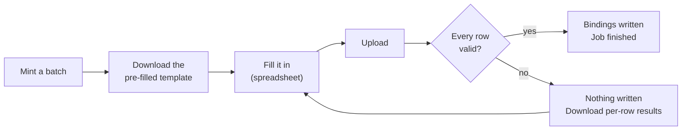

# Using the ARK service

Every task, in both places you can do it. There is **no HTTP API** — anything a
script needs to do, it does with a management command on the host.

| | Staff interface | Command line |
|---|---|---|
| Where | `https://<host>/admin/` | on the server, as `www-data` |
| Who | signed-in user with a role | anyone with shell access (no role check) |
| Good for | day-to-day work, browsing, one-off edits | automation, bulk work, migration |

Commands below are written as `manage.py …`; in production that is:

```bash
sudo -u www-data /var/www/arkservice/.venv/bin/python \
     /var/www/arkservice/manage.py <command>
```

Set an alias to save your fingers:

```bash
alias ark='sudo -u www-data /var/www/arkservice/.venv/bin/python /var/www/arkservice/manage.py'
```

---

## Contents

- [Who can do what](#who-can-do-what)
- [1. Set up a new collection](#1-set-up-a-new-collection)
- [2. Mint ARKs](#2-mint-arks)
- [3. Bind metadata to one ARK](#3-bind-metadata-to-one-ark)
- [4. Bulk bind from a spreadsheet](#4-bulk-bind-from-a-spreadsheet) ← the usual workflow
- [5. Hierarchies and variants](#5-hierarchies-and-variants)
- [6. Search and export](#6-search-and-export)
- [7. Resolve an ARK](#7-resolve-an-ark)
- [8. Correct a mistake](#8-correct-a-mistake)
- [9. Retire an ARK](#9-retire-an-ark)
- [10. Reports](#10-reports)
- [11. Manage users](#11-manage-users)
- [12. Migrate from the legacy service](#12-migrate-from-the-legacy-service)
- [Templates reference](#templates-reference)
- [CSV reference](#csv-reference)

---

## Who can do what

| | Admin | Editor | Viewer |
|---|:--:|:--:|:--:|
| Search, browse, export | ✅ | ✅ | ✅ |
| Mint | ✅ | ✅ | — |
| Bind / unbind, bulk bind | ✅ | ✅ | — |
| Create / edit collections | ✅ | — | — |
| Purge all elements from an ARK | ✅ | — | — |
| Manage users and roles | ✅ | — | — |

A user with **no** role can sign in and do nothing — accounts are inert until an
Admin assigns a role at `/admin/users/`. A Django superuser is always Admin.

---

## 1. Set up a new collection

A collection is a minter: one prefix, one NAAN, one noid template. **The prefix
must be unique** across the whole service.

**Command line**

```bash
manage.py createcollection "UTSC Digital Collections" \
    --prefix utsc \
    --naan 61220 \
    --naa "University of Toronto Scarborough Library" \
    --template .zd \
    --term medium
```

It prints back what it made, including how many identifiers the template can
produce:

```
Created collection 'UTSC Digital Collections'
  prefix   utsc
  firstpart 61220/utsc
  template .zd (mask zd, sequential)
  capacity unlimited
```

**Staff interface** — Collections → *New collection* (Admin only).

**Choosing a template** — see [Templates reference](#templates-reference). If in
doubt use `.zd`: sequential digits, no ceiling, grows as needed. That is what
production uses.

> **The prefix, NAAN and template cannot be changed once ARKs exist.** Changing
> them would break identifiers already in circulation. Only the name and NAA are
> editable afterwards.

---

## 2. Mint ARKs

Minting creates identifiers. They do not resolve until something is bound to
them.

**Command line**

```bash
manage.py mint utsc 500                              # print the new ARKs
manage.py mint utsc 500 --template /tmp/batch.csv    # ...and write a fill-in CSV
```

**Staff interface** — Collections → *(collection)* → **Mint**. Enter a count,
then download the pre-filled template from the result page.

The collection can be named by prefix or by name; `utsc` and
`"UTSC Digital Collections"` both work.

A single request is capped at `MINT_MAX_PER_REQUEST` (default 10,000). Larger
batches would build every identifier inside one transaction while holding the
collection lock, blocking other minters. Run several batches instead.

The cap is a deployment setting: raise `MINT_MAX_PER_REQUEST`, or set it to `0`
to remove it. The staff form mints inside the web request, so a batch that takes
longer than the gunicorn timeout fails — nothing is minted — however high the
cap is set.

Minting is safe to run concurrently: two people minting at the same moment
cannot produce the same ARK.

---

## 3. Bind metadata to one ARK

**Any element name is allowed.** `URL`, `PID`, `LOCAL_ID` and `COLLECTION` are
conventions, not a fixed schema — bind `PHOTOGRAPHER` or `RIGHTS_STATEMENT` if
that is what the collection needs. Names are stored upper-case.

```bash
manage.py bind 61220/utsc1 URL https://digital.utsc.utoronto.ca/object/utsc:1
manage.py bind 61220/utsc1 PID islandora:1
manage.py bind 61220/utsc1 PHOTOGRAPHER "Ansel Adams"
```

Binding the same element again replaces its value.

**Staff interface** — ARKs → *(the ARK)* → *Bind an element*.

**What makes an ARK resolve:** the resolver looks for `URL`, and falls back to
`WHERE?`. Anything else is metadata that shows up under the `?` inflection.

---

## 4. Bulk bind from a spreadsheet

The usual workflow, and the one the whole system is shaped around.



### Step 1 — mint and get the template

```bash
manage.py mint utsc 500 --template /tmp/batch.csv
```

Or in the UI: **Mint**, then *Download template CSV*.

The file arrives with `Ark_ID` already filled in:

```csv
Ark_ID,URL,PID,LOCAL_ID,COLLECTION
61220/utsc0,,,,
61220/utsc1,,,,
```

### Step 2 — fill it in

Add values, and add any columns you like — each new column becomes an element.

```csv
Ark_ID,URL,PID,LOCAL_ID,COLLECTION,PHOTOGRAPHER
61220/utsc0,https://example.org/0,islandora:0,obj-0,Maps,Ansel Adams
61220/utsc1,https://example.org/1,islandora:1,obj-1,Maps,Berenice Abbott
```

Save as **CSV UTF-8**. Windows-1252 (plain "CSV" in Excel on Windows) is read
correctly too, but UTF-8 avoids any doubt.

### Step 3 — upload

```bash
manage.py bulk_bind utsc /tmp/batch.csv --results /tmp/results.csv
```

**Staff interface** — Collections → *(collection)* → **Bulk bind**. The job runs
in the background; the page refreshes itself, and you can close the tab and come
back to it.

### If something is wrong with the file

**The whole file is validated before anything is written**, so a bad row cannot
leave the collection half-updated. If any row fails, nothing at all is written
and you get a per-row results CSV:

```csv
row,ark_id,status,message
2,61220/utsc0,ok,
3,61220/nope,error,61220/nope is not an ARK in this collection. Mint it first.
```

Fix those rows and upload the whole file again.

### Options

| Option | UI equivalent | Effect |
|---|---|---|
| `--mint-missing` | *Mint new ARKs for rows with a blank Ark_ID* | Blank `Ark_ID` rows get a freshly minted ARK; the results CSV reports which |
| `--purge-first` | *Remove existing elements from these ARKs first* | Clears exactly the `(ARK, qualifier)` pairs the file names before binding |
| `--results PATH` | download link on the job page | Per-row outcome |

**An empty cell leaves the existing value alone.** To clear a value, use
`--purge-first`, or `unbind`.

---

## 5. Hierarchies and variants

An `Ark_ID` may carry a qualifier, and qualifiers are created simply by binding
to them — nothing is minted for a part.

| Written as | Means |
|---|---|
| `61220/utsc1` | the object itself |
| `61220/utsc1/page1` | a hierarchical part |
| `61220/utsc1.image.png` | a variant of the object |
| `61220/utsc1/page1.image.png` | a variant of a part |

```bash
manage.py bind 61220/utsc1/page1 URL https://example.org/1/p1
manage.py bind 61220/utsc1/page1.image.png URL https://example.org/1/p1.png
```

Or as CSV rows:

```csv
Ark_ID,URL
61220/utsc1/page1,https://example.org/1/p1
61220/utsc1/page1.image.png,https://example.org/1/p1.png
```

> **There is no fallback up the hierarchy.** Requesting `/ark:/61220/utsc1/page9`
> when nothing is bound to `/page9` returns 404, even if the object itself
> resolves. This matches the legacy service exactly, and existing ARKs depend on
> it.

---

## 6. Search and export

Search reaches **any element name**, and free text searches identifiers and
every bound value.

**Staff interface** — ARKs. Filters: free text, collection, element name, exact
value, bound/unbound, minimum redirects, minted-after / minted-before. Any
result can be exported with *Export these as CSV*.

**Command line**

```bash
manage.py export_arks --collection utsc --out /tmp/utsc.csv
manage.py export_arks --text "utsc:4242" --out /tmp/found.csv
manage.py export_arks --element PID --value islandora:7 --out /tmp/one.csv
manage.py export_arks --collection utsc --unbound --out /tmp/todo.csv
manage.py export_arks --min-redirects 500 --out /tmp/popular.csv
manage.py export_arks --minted-after 2026-01-01 --out /tmp/recent.csv
manage.py export_arks --collection utsc            # stdout
```

**Export round-trips into bulk bind.** One row per ARK-and-qualifier, `Ark_ID`
first, a column per element — exactly what an upload expects. So the way to
change many values at once is: export, edit in a spreadsheet, upload.

Unbound ARKs are included, which makes an export double as a fill-in template.

---

## 7. Resolve an ARK

This is what the public does. Nothing needs to be signed in.

| Request | Result |
|---|---|
| `/ark:/61220/utsc1` | 302 to the `URL` binding (or `WHERE?` if there is no `URL`) |
| `/ark:/61220/utsc1/page1` | 302 to that part's own URL |
| `/ark:/61220/utsc1?` | brief metadata, `erc:` block, `text/plain` |
| `/ark:/61220/utsc1??` | brief plus `erc-support:` (elements whose name contains `??`) |
| `/ark:/61220/utsc1?info` | same as `??` |
| `/ark:/61220/utsc1/manifest` | fetches the target and returns its JSON (IIIF pass-through) |
| `/ark:/61220/` | the collection's Name Assigning Authority |
| anything unbound or unknown | 404 |

```bash
curl -sI 'https://ark.digital.utsc.utoronto.ca/ark:/61220/utsc1' | head -2
curl -s  'https://ark.digital.utsc.utoronto.ca/ark:/61220/utsc1?'
curl -s  'https://ark.digital.utsc.utoronto.ca/ark:/61220/'
```

Every redirect increments a per-(ARK, qualifier) counter, shown in the staff
interface. Metadata and manifest requests are **not** counted as redirects.

`/manifest` will only fetch `http`/`https` targets on public addresses; a
`file://` or internal-network URL is refused with a 502.

---

## 8. Correct a mistake

**One value:**

```bash
manage.py bind 61220/utsc1 URL https://example.org/moved
```

**Many values** — export, edit, upload:

```bash
manage.py export_arks --collection utsc --out /tmp/fix.csv
# edit /tmp/fix.csv
manage.py bulk_bind utsc /tmp/fix.csv --results /tmp/results.csv
```

**Remove one element:**

```bash
manage.py unbind 61220/utsc1 PHOTOGRAPHER            # from the object itself
manage.py unbind 61220/utsc1/page1 PHOTOGRAPHER      # from that part
```

**Replace an ARK's metadata wholesale** — upload just that ARK with
`--purge-first`.

---

## 9. Retire an ARK

An identifier is **never** reissued: purging removes the elements but keeps the
ARK, so it can never be minted again for something else.

```bash
manage.py unbind 61220/utsc1 --all           # the ARK and every part of it
manage.py unbind 61220/utsc1/page1 --all     # just that part
```

On a bare ARK, `--all` clears **every qualifier too**, so nothing belonging to
the object resolves afterwards. Name a qualifier to scope it to that part. This
is the same thing the UI's *Purge all elements* does.

**Staff interface** — ARKs → *(the ARK)* → *Danger zone* → **Purge all
elements** (Admin only).

Afterwards the ARK returns 404. To point it somewhere instead — a tombstone page
explaining what happened — bind a new `URL` rather than purging.

---

## 10. Reports

```bash
manage.py ark_stats
```

```
PREFIX      NAAN    TEMPLATE          ARKS     BOUND  ELEMENTS   REDIRECTS
--------------------------------------------------------------------------
utsc        61220   .zd            100,000    99,998   418,182   6,382,810

Most used elements:
  URL                        100,000
  LOCAL_ID                   100,000
```

The collection page in the staff interface shows the same counts, plus recent
bulk-bind jobs.

For anything more specific, filter in the ARKs table and export.

---

## 11. Manage users

Accounts are created on the server; roles are assigned in the UI.

```bash
manage.py createsuperuser          # always an Admin
```

**Staff interface** — Users (Admin only). Pick a role per account, or *No role*
to suspend someone's access without deleting them.

Legacy staff accounts are **not** migrated — they used a reversible password
scheme that had to go. Create accounts fresh.

---

## 12. Migrate from the legacy service

Full runbook in [MIGRATION.md](MIGRATION.md). In brief:

```bash
# 1. read the export straight from the file — no scratch database
manage.py import_legacy --legacy-dump /srv/ARK_CORE.sql --report review.csv --dry-run
manage.py import_legacy --legacy-dump /srv/ARK_CORE.sql --report review.csv
manage.py ark_stats

# 2. prove every ARK resolves identically before flipping anything
manage.py resolve_diff \
    --legacy-base https://ark.digital.utsc.utoronto.ca \
    --new-base http://127.0.0.1:8000 --known review.csv --out cutover-diff.csv
```

`import_legacy` is idempotent — rehearse it as often as you like. `review.csv`
lists the few rows that could not be carried over exactly, and `resolve_diff`
exits non-zero until every path that is not in it matches.

To rehearse the whole thing in Docker instead, see
[`MIGRATION.md` in `docker-arks-service`](https://github.com/digitalutsc/docker-arks-service/blob/main/MIGRATION.md).

---

## Templates reference

A template is a prefix plus a mask. The mask's first letter chooses the order,
the rest choose the character repertoires, and a trailing `k` adds a check
character.

| Template | Produces | Capacity |
|---|---|---|
| `.zd` | sequential digits, growing as needed — `utsc0`, `utsc1`, … `utsc100000` | unlimited |
| `.zeee` | sequential extended digits, at least three | unlimited |
| `.sdddddd` | sequential 6-digit numbers | 1,000,000 |
| `.sdd` | sequential 2-digit numbers | 100 |
| `.rddd` | random 3-digit numbers | 1,000 |
| `.rdddd` | random 4-digit numbers | 10,000 |
| `.rdedk` | random mixed digits plus a check character | 8,410 |
| `.reedeedk` | random, 6 mixed characters plus a check character | 70,728,100 |

- **`z`** sequential, unlimited · **`s`** sequential, fixed width · **`r`** random
- **`d`** digits · **`e`** extended digits (`0-9bcdfghjkmnpqrstvwxz` — no vowels,
  so no accidental words) · **`k`** check character

Production uses `.zd`. Check characters let a mistyped ARK be detected rather
than silently resolving to the wrong thing; they cost nothing but length.

---

## CSV reference

**Encoding** — UTF-8 preferred; Windows-1252 is read as a fallback. A file that
is neither fails the job with a message rather than corrupting values.

**Required column** — `Ark_ID` (case-insensitive). Every other column becomes an
element named after the column header, upper-cased.

**Cells**

| Cell | Meaning |
|---|---|
| a value | bind it, replacing anything there |
| empty | leave any existing value alone |
| an `Ark_ID` with a qualifier | bind under that qualifier |
| a blank `Ark_ID` | rejected, unless `--mint-missing` |

**Limits** — `BULK_BIND_MAX_ROWS` rows (default 100,000) and
`DATA_UPLOAD_MAX_MEMORY_SIZE` bytes (default 20 MB) per upload. Split larger
files.

**Rejected outright** (nothing is written, the whole file is reported):

- no `Ark_ID` column;
- an ARK that does not exist, or belongs to another collection;
- the same ARK-and-element set twice in one file.
