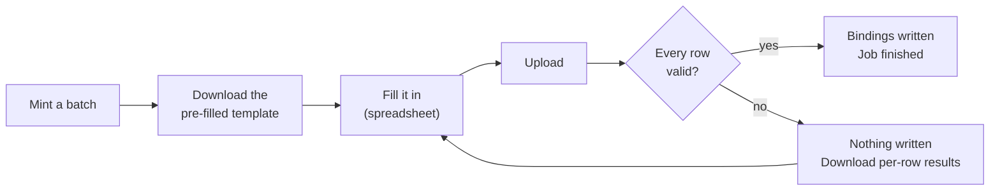

# Using the ARK service

Every task, in both places you can do it. There is **no HTTP API** — anything a
script needs to do, it does with a management command on the host.

| | Staff interface | Command line |
|---|---|---|
| Where | `https://<host>/admin/` | on the server, as `www-data` |
| Who | signed-in user with a role | anyone with shell access (no role check) |
| Good for | day-to-day work, browsing, one-off edits | automation, bulk work, migration |

> **The staff commands are an optional plugin.** `createcollection`, `mint`,
> `bind`, `unbind`, `bulk_bind` and `ark_stats` are the separate
> [`arks-cli`](../../arks-cli) package. Everything they do can also be done in the
> staff interface, so many servers will not have them. To use them, install the
> plugin and set `ARKS_PLUGINS=arks_cli` in `.env` (`docs/DEPLOY.md` §4.2). The
> operator commands (`export_arks`, `import_legacy`, `resolve_diff`,
> `check_manifests`, `flush_counters`, `refresh_collection_stats`,
> `prune_bulk_jobs`) are always there.

Commands below are written as `manage.py …`; in production that is:

```bash
sudo -u www-data /var/www/arkservice/.venv/bin/python \
     /var/www/arkservice/manage.py <command>
```

Set an alias to save your fingers:

```bash
alias ark='sudo -u www-data /var/www/arkservice/.venv/bin/python /var/www/arkservice/manage.py'
```

---

## Contents

- [Who can do what](#who-can-do-what)
- [1. Set up a new collection](#1-set-up-a-new-collection)
- [2. Mint ARKs](#2-mint-arks)
- [3. Bind metadata to one ARK](#3-bind-metadata-to-one-ark)
- [4. Bulk bind from a spreadsheet](#4-bulk-bind-from-a-spreadsheet) ← the usual workflow
- [5. Hierarchies and variants](#5-hierarchies-and-variants)
- [6. Search and export](#6-search-and-export)
- [7. Resolve an ARK](#7-resolve-an-ark)
- [8. Correct a mistake](#8-correct-a-mistake)
- [9. Retire an ARK](#9-retire-an-ark)
- [10. Reports](#10-reports)
- [11. Manage users](#11-manage-users)
- [12. Migrate from the legacy service](#12-migrate-from-the-legacy-service)
- [Templates reference](#templates-reference)
- [CSV reference](#csv-reference)

---

## Who can do what

| | Superuser | Admin | Editor | Viewer |
|---|:--:|:--:|:--:|:--:|
| Browse a collection's ARKs, search, export | ✅ | ✅ | ✅ | ✅ |
| Mint | ✅ | ✅ | ✅ | — |
| Bind / unbind, bulk bind | ✅ | ✅ | ✅ | — |
| Create / edit collections | ✅ | ✅ | — | — |
| Purge all elements from an ARK | ✅ | ✅ | — | — |
| Change other people's roles | ✅ | ✅ | — | — |
| Add and delete accounts | ✅ | — | — | — |

A user with **no** role can sign in and do nothing — accounts are inert until
someone assigns a role at `/admin/users/`. A Django superuser (`createsuperuser`)
is always Admin, whatever groups it is in, so its row has no role control; and
nobody changes their own role from the page, so nobody locks themselves out.

---

## 1. Set up a new collection

A collection is a minter: one prefix, one NAAN, one noid template. **The prefix
must be unique** across the whole service.

**Command line** (needs the `arks-cli` plugin)

```bash
manage.py createcollection "UTSC Digital Collections" \
    --prefix utsc \
    --naan 61220 \
    --naa "University of Toronto Scarborough Library" \
    --template .zd \
    --term medium
```

Three optional settings decide how the collection's ARKs resolve. The defaults are
the legacy service's behaviour, so most collections never set them:

| Flag (form field) | Default | Meaning |
|---|---|---|
| `--redirect-elements` (*Redirect elements*) | `URL,WHERE?` | Elements holding an ARK's redirect URL, in order. The first one bound with a value wins, at whatever qualifier is requested |
| `--suffix-passthrough` (*Suffix passthrough*) | off | A part with no URL of its own redirects to the nearest bound part's URL plus the rest of the path (section 5) |
| `--proxied-suffixes` (*Proxied suffixes*) | `manifest` | Final path segments answered with the target's JSON instead of a redirect. `''` for none. One plain segment each: no `/ . ? # % -`, not starting with a digit or `_` |

It prints back what it made, including how many identifiers the template can
produce:

```
Created collection 'UTSC Digital Collections'
  prefix   utsc
  firstpart 61220/utsc
  template .zd (mask zd, sequential)
  capacity unlimited
  redirects from URL, WHERE?
  proxied suffixes manifest
```

**Staff interface** — Collections → *New collection* (Admin only).

**Choosing a template** — see [Templates reference](#templates-reference). If in
doubt use `.zd`: sequential digits, no ceiling, grows as needed. That is what
production uses.

> **The prefix, NAAN and template cannot be changed once ARKs exist.** Changing
> them would break identifiers already in circulation. Only the name and NAA are
> editable afterwards, plus the two resolution settings, behind a preview (see
> [Resolve an ARK](#7-resolve-an-ark)).

---

## 2. Mint ARKs

Minting creates identifiers. They do not resolve until something is bound to
them.

**Command line** (needs the `arks-cli` plugin)

```bash
manage.py mint utsc 500                              # print the new ARKs
manage.py mint utsc 500 --template /tmp/batch.csv    # ...and write a fill-in CSV
```

**Staff interface** — Collections → *(collection)* → **Mint** tab. Enter a count,
then download the pre-filled template from the result page. The mint runs while
the page waits (the button reads "Minting…"); a capped batch takes a second or two.

The collection can be named by prefix or by name; `utsc` and
`"UTSC Digital Collections"` both work.

A single request is capped at `MINT_MAX_PER_REQUEST` (default 10,000). Larger
batches would build every identifier inside one transaction while holding the
collection lock, blocking other minters. Run several batches instead.

The cap is a deployment setting: raise `MINT_MAX_PER_REQUEST`, or set it to `0`
to remove it. Bulk bind is not subject to it; its own ceiling is
`BULK_BIND_MAX_ROWS`. The staff form mints inside the web request: a very large
batch can outlast Apache's proxy timeout, in which case the browser shows an
error page but the mint still completes. Check the collection before retrying.

Minting is safe to run concurrently: two people minting at the same moment
cannot produce the same ARK.

---

## 3. Bind metadata to one ARK

**Any element name is allowed.** `URL`, `PID`, `LOCAL_ID` and `COLLECTION` are
conventions, not a fixed schema — bind `PHOTOGRAPHER` or `RIGHTS_STATEMENT` if
that is what the collection needs. Names are stored upper-case.

```bash
manage.py bind 61220/utsc1 URL https://digital.utsc.utoronto.ca/object/utsc:1
manage.py bind 61220/utsc1 PID islandora:1
manage.py bind 61220/utsc1 PHOTOGRAPHER "Ansel Adams"
```

Binding the same element again replaces its value.

**Staff interface** — ARKs → *(the ARK)* → *Bind an element*.

**What makes an ARK resolve:** the resolver looks for `URL`, and falls back to
`WHERE?`. Anything else is metadata that shows up under the `?` inflection.

---

## 4. Bulk bind from a spreadsheet

The usual workflow, and the one the whole system is shaped around.



### Step 1 — mint and get the template

```bash
manage.py mint utsc 500 --template /tmp/batch.csv
```

Or in the UI: **Mint**, then *Download template CSV*.

The file arrives with `Ark_ID` already filled in:

```csv
Ark_ID,URL,PID,LOCAL_ID,COLLECTION
61220/utsc0,,,,
61220/utsc1,,,,
```

### Step 2 — fill it in

Add values, and add any columns you like — each new column becomes an element.

```csv
Ark_ID,URL,PID,LOCAL_ID,COLLECTION,PHOTOGRAPHER
61220/utsc0,https://example.org/0,islandora:0,obj-0,Maps,Ansel Adams
61220/utsc1,https://example.org/1,islandora:1,obj-1,Maps,Berenice Abbott
```

Save as **CSV UTF-8**. Windows-1252 (plain "CSV" in Excel on Windows) is read
correctly too, but UTF-8 avoids any doubt.

### Step 3 — upload

```bash
manage.py bulk_bind utsc /tmp/batch.csv --results /tmp/results.csv
```

**Staff interface** — Collections → *(collection)* → **Bulk bind** tab. The job
runs in the background; the job page refreshes itself with a progress bar
(reading the file, checking rows, minting, writing bindings), and you can close
the tab and come back to it. The collection's **Browse ARKs** tab shows a line
while a bulk bind is running there, and afterwards says what the last one did.

### If something is wrong with the file

**The whole file is validated before anything is written**, so a bad row cannot
leave the collection half-updated. If any row fails, nothing at all is written
and you get a per-row results CSV:

```csv
row,ark_id,status,message
2,61220/utsc0,ok,Not applied: another row in the file failed.
3,61220/nope,error,61220/nope is not an ARK in this collection. Mint it first.
```

Fix those rows and upload the whole file again.

When the file succeeds, every row says what happened to its elements:

| Status | Meaning | Message |
|---|---|---|
| `bound` | at least one element was created or replaced | `3 created, 1 replaced, 2 unchanged` (with `--purge-first`: `6 created (previous elements removed)`) |
| `unchanged` | every non-empty cell already held that value | `6 unchanged`, or `nothing to bind` |
| `minted` | blank `Ark_ID`; a new ARK was minted and its cells bound | `minted; 6 created` |
| `ok` | the row was valid but **nothing was applied**, because another row failed | `Not applied: another row in the file failed.` |
| `error` | the row itself was rejected | the reason |

In the staff interface the job page (*Recent uploads* → **Details**) lists the
same rows under the same four columns, fifty to a page, with a count for *All*,
*Errors*, *Minted*, *Bound*, *Unchanged* and *Not applied*. A job with failures
opens on *Errors*, so the rows to fix are in front of you however long the file was. The search box above the
table finds rows by ARK or by message, ignoring case; the counts on the filters
follow the search, so they show which status the matches are under. The table is
read from the results file itself, so it always matches the download.

### Options

| Option | UI equivalent | Effect |
|---|---|---|
| `--mint-missing` | *Mint new ARKs for rows with a blank Ark_ID* | Blank `Ark_ID` rows get a freshly minted ARK; the results CSV reports which |
| `--purge-first` | *Remove existing elements from these ARKs first* | Clears exactly the `(ARK, qualifier)` pairs the file names before binding |
| `--results PATH` | download link on the job page | Per-row outcome |

**An empty cell leaves the existing value alone.** To clear a value, use
`--purge-first`, or `unbind`.

---

## 5. Hierarchies and variants

An `Ark_ID` may carry a qualifier, and qualifiers are created simply by binding
to them — nothing is minted for a part.

| Written as | Means |
|---|---|
| `61220/utsc1` | the object itself |
| `61220/utsc1/page1` | a hierarchical part |
| `61220/utsc1.image.png` | a variant of the object |
| `61220/utsc1/page1.image.png` | a variant of a part |

```bash
manage.py bind 61220/utsc1/page1 URL https://example.org/1/p1
manage.py bind 61220/utsc1/page1.image.png URL https://example.org/1/p1.png
```

Or as CSV rows:

```csv
Ark_ID,URL
61220/utsc1/page1,https://example.org/1/p1
61220/utsc1/page1.image.png,https://example.org/1/p1.png
```

**Staff interface** — the ARK's page lists the object's own elements first, under
*Bound elements*, and then its qualifiers in a table of their own under
*Variants*, one row each: the qualifier, its public URL, its elements and its
redirect count. As in the ARK list, a row shows four elements with values cut at
60 characters (the whole value on hover); *+N more* opens the rest in place. Rows are in counting order (`/p2` before `/p10`). The
search box above the table keeps only the variants whose qualifier, or any
element name or value, contains the term (case is ignored). Click a heading to
sort, and again to reverse: *Variant* and *Public URL* sort alike, *Elements* by
how many are bound, *Redirects* by count, with ties left in counting order. Search
and sort are both in the address, and an edit keeps them. Editors get a
*Remove* beside each element, shown on hover or keyboard focus; binding to or
removing from a variant brings you back to its row.

> **There is no fallback up the hierarchy**, unless the collection turns on suffix
> passthrough. Requesting `/ark:/61220/utsc1/page9` when nothing is bound to
> `/page9` returns 404, even if the object itself resolves. This matches the
> legacy service exactly, and existing ARKs depend on it.
>
> **Suffix passthrough** (a collection setting, off by default) changes that for
> one collection: a part with no URL of its own redirects to the nearest bound
> part's URL plus the rest of the path. If `utsc1` goes to `https://site/utsc1`,
> then `utsc1/page9` goes to `https://site/utsc1/page9`, and new parts need no
> binding if their pages follow that pattern. A part with its own URL always
> uses it; metadata (`?`, `??`, `?info`) and `/manifest` are not affected; paths
> with `.` or `..` segments are refused; the redirect is counted against the
> part that supplied the URL. The cost: a mistyped part reaches the target
> site's "not found" page instead of ours.

> **Spelling is forgiven, as the ARK spec asks.** `/ARK:/61220/utsc1`,
> `/ark:/61220/utsc-1` and `/ark:/61220/utsc1.` (a citation pasted with its full
> stop) all resolve to `utsc1`; `/ark:/61220/utsc1/page-2` reaches `/page2`.
> A variant of the object, `/ark:/61220/utsc1.image.png`, resolves to what is
> bound at `.image.png` on `utsc1`.
> The request as written is always tried first. In return, a qualifier or a new
> collection prefix may not contain a hyphen: N2T and arks.org remove hyphens
> before forwarding a request to us, so it could never be resolved through them.
> The ARK page, `bind` and bulk bind all refuse one with that explanation.

---

## 6. Search and export

Search reaches **any element name**, and free text searches identifiers and
every bound value.

**Staff interface** — Collections → *(collection)* → **Browse ARKs** tab. ARKs
are browsed one collection at a time; `/admin/arks/` without a collection sends
you back to Collections. Filters: free text, element name, exact value,
bound/unbound, minimum redirects, minted-after / minted-before. The result line
offers *Export these N as CSV* for the rows that match; the collection's
*Overview* tab offers *Export all N as CSV*.

Free text has two modes, chosen with *Match*:

- **Starts with** (the default) finds ARKs whose identifier, or any bound
  value, *begins* with the text, ignoring case: `utsc12` finds `utsc12` and
  `utsc1234`; `islandora:7` finds the ARK whose PID is `islandora:7…`. It uses
  indexes, so it is quick at any collection size. If more than 50,000 ARKs
  match, it says so and asks for more characters instead of showing a partial
  list.
- **Contains** finds the text anywhere. It reads every bound value, which on a
  collection of millions of ARKs takes many seconds per search.

An export from the staff interface is limited to `EXPORT_SYNC_MAX_ROWS`
(100,000 by default). A bigger one, such as a whole large collection, shows the
equivalent `export_arks` command to run on the server instead.

Click a column heading to sort by it, and again to reverse the order. *ARK* and
*Public URL* sort alike, *Elements* sorts by how many elements are bound, and
*Redirects* by the total across qualifiers. The order is part of the address
(`?sort=-minted`), so it survives paging, a change of filter and a bookmark; it
does not affect an export. Sorting by *Elements* or *Redirects* has no index to
lean on, so they are only offered when the list holds at most
`SORT_SUBQUERY_MAX_ROWS` ARKs (50,000 by default); a larger list stays in ARK
order and says to narrow it first.

**Command line** (core: always available)

```bash
manage.py export_arks --collection utsc --out /tmp/utsc.csv
manage.py export_arks --text "utsc:4242" --out /tmp/found.csv   # contains, anywhere
manage.py export_arks --element PID --value islandora:7 --out /tmp/one.csv
manage.py export_arks --collection utsc --unbound --out /tmp/todo.csv
manage.py export_arks --min-redirects 500 --out /tmp/popular.csv
manage.py export_arks --minted-after 2026-01-01 --out /tmp/recent.csv
manage.py export_arks --collection utsc            # stdout
```

**Export round-trips into bulk bind.** One row per ARK-and-qualifier, `Ark_ID`
first, a column per element — exactly what an upload expects. So the way to
change many values at once is: export, edit in a spreadsheet, upload.

Unbound ARKs are included, which makes an export double as a fill-in template.

---

## 7. Resolve an ARK

This is what the public does. Nothing needs to be signed in.

| Request | Result |
|---|---|
| `/ark:/61220/utsc1` | 302 to the `URL` binding (or `WHERE?` if there is no `URL`): the collection's redirect elements, these by default |
| `/ark:/61220/utsc1/page1` | 302 to that part's own URL |
| `/ark:/61220/utsc1?` | brief metadata, `erc:` block, `text/plain` |
| `/ark:/61220/utsc1??` | brief plus `erc-support:` (elements whose name contains `??`) |
| `/ark:/61220/utsc1?info` | same as `??` |
| `/ark:/61220/utsc1/manifest` | fetches the URL bound at `/manifest` (a pre-generated IIIF manifest), else the object's own URL, and returns its JSON. `manifest` is the default proxied suffix |
| `/ark:/61220/utsc1/manifest?` | the metadata of the `/manifest` qualifier (no fetch) |
| `/ark:/61220/` | the collection's Name Assigning Authority |
| anything unbound or unknown | 404 |

```bash
curl -sI 'https://ark.digital.utsc.utoronto.ca/ark:/61220/utsc1' | head -2
curl -s  'https://ark.digital.utsc.utoronto.ca/ark:/61220/utsc1?'
curl -s  'https://ark.digital.utsc.utoronto.ca/ark:/61220/'
```

Every redirect increments a per-(ARK, qualifier) counter, shown in the staff
interface. Metadata and manifest requests are **not** counted as redirects.

`/manifest` will only fetch `http`/`https` targets on public addresses; a
`file://` or internal-network URL is refused with a 502. It does not follow
redirects, so bind the final manifest URL. It waits up to 30 s, legacy's limit,
so manifests built on demand (which send nothing for 20–35 s the first time)
still arrive.
Manifest responses carry `Access-Control-Allow-Origin: *`, so a IIIF viewer
(Mirador, Universal Viewer) on another site can load
`https://ark.digital.utsc.utoronto.ca/ark:/…/manifest` directly.

To check every manifest at once, read-only, the same way the resolver fetches
them:

```bash
manage.py check_manifests --collection utsc --out manifests.csv   # --workers 4, --sample N
```

It prints a summary (`ok`, `empty`, `not-json`, `too-large`, `too-slow`,
`redirect`, `http-error`, `refused`, `failed`), the slowest one and the first
problems; the CSV has every row. Each row is one GET to the target's site, so
keep `--workers` low for sites that build manifests on demand. Only targets
bound at a proxied suffix are checked.

### Changing a collection's resolution settings

Collection page → *Resolution settings* (Admin only). *Review change…* shows,
without saving anything, the settings now and after, how many bindings carry
each redirect element and how many ARKs bind each suffix, and a warning for
every change that alters what existing ARKs answer (an element bound nowhere,
an element in use being dropped, a reordered list, suffix passthrough turned
on or off, a suffix in use being
added or removed). Tick the box and *Confirm change* to save. It applies from the
next request. The page shows when and by whom the settings were last changed,
and the app log keeps every change (`WARNING core.services collection …: redirect
elements A -> B; proxied suffixes C -> D by <user>`). There is no command-line
equivalent on purpose: the preview is the safeguard.

---

## 8. Correct a mistake

**One value:**

```bash
manage.py bind 61220/utsc1 URL https://example.org/moved
```

**Many values** — export, edit, upload:

```bash
manage.py export_arks --collection utsc --out /tmp/fix.csv
# edit /tmp/fix.csv
manage.py bulk_bind utsc /tmp/fix.csv --results /tmp/results.csv
```

**Remove one element:**

```bash
manage.py unbind 61220/utsc1 PHOTOGRAPHER            # from the object itself
manage.py unbind 61220/utsc1/page1 PHOTOGRAPHER      # from that part
```

**Replace an ARK's metadata wholesale** — upload just that ARK with
`--purge-first`.

---

## 9. Retire an ARK

An identifier is **never** reissued: purging removes the elements but keeps the
ARK, so it can never be minted again for something else.

```bash
manage.py unbind 61220/utsc1 --all           # the ARK and every part of it
manage.py unbind 61220/utsc1/page1 --all     # just that part
```

On a bare ARK, `--all` clears **every qualifier too**, so nothing belonging to
the object resolves afterwards. Name a qualifier to scope it to that part. This
is the same thing the UI's *Purge all elements* does.

**Staff interface** — ARKs → *(the ARK)* → *Danger zone* → **Purge all
elements** (Admin only).

Afterwards the ARK returns 404. To point it somewhere instead — a tombstone page
explaining what happened — bind a new `URL` rather than purging.

---

## 10. Reports

```bash
manage.py ark_stats
```

```
PREFIX      NAAN    TEMPLATE          ARKS     BOUND  ELEMENTS   REDIRECTS
--------------------------------------------------------------------------
utsc        61220   .zd            100,000    99,998   418,182   6,382,810

Most used elements:
  URL                        100,000
  LOCAL_ID                   100,000
```

The collection page in the staff interface shows the same counts, plus recent
bulk-bind jobs. A collection of 50,000 ARKs or more is not recounted on every
view: the scheduler recounts every collection every `COLLECTION_STATS_SECONDS`
(five minutes by default) and the page says when ("Counts as of 14:05"). To
recount now:

```bash
manage.py refresh_collection_stats          # every collection
manage.py refresh_collection_stats utsc     # one
```

Finished bulk-bind jobs keep their uploaded file and results file. To clear out
old ones (or set `BULK_BIND_RETENTION_DAYS` to do it daily):

```bash
manage.py prune_bulk_jobs --older-than 180 --dry-run
manage.py prune_bulk_jobs --older-than 180
```

For anything more specific, filter in the ARKs table and export.

---

## 11. Manage users

Accounts are created on the server; roles are assigned in the UI.

```bash
manage.py createsuperuser          # always an Admin
```

**Staff interface** — Users (Admin and superusers). Pick a role per account, or
*No role* to suspend someone's access without deleting them. You cannot change
your own role, and a superuser's row has no role control (a superuser is always
Admin).

A **superuser** can also add accounts on the same page (username, optional
email and name, a password that passes Django's validators, an initial role)
and delete them. Deleting is final; the person's ARKs and uploads are kept and
show no owner afterwards. Superusers themselves are only ever created on the
server with `createsuperuser`.

Legacy staff accounts are **not** migrated — they used a reversible password
scheme that had to go. Create accounts fresh.

**Fallback pages** (superusers). The landing page at `/`, the 404 for an unknown
or unbound ARK and the 500 page can be replaced by files in a directory on the
server named by `FALLBACK_PAGES_DIR` (`docs/fallback-example/` is a starting
kit, `docs/fallback-example/` from the repository root). They are edited on the server, not here; the bottom of the Users page
shows which are in place and previews each. Signed-in staff who open a page
above their role see the staff interface's own message, not the public
`403.html`.

---

## 12. Migrate from the legacy service

Full runbook in [MIGRATION.md](MIGRATION.md). In brief:

```bash
# 1. read the export straight from the file — no scratch database
manage.py import_legacy --legacy-dump /srv/ARK_CORE.sql --report review.csv --dry-run
manage.py import_legacy --legacy-dump /srv/ARK_CORE.sql --report review.csv
manage.py ark_stats

# 2. prove every ARK resolves identically before flipping anything
manage.py resolve_diff \
    --legacy-base https://ark.digital.utsc.utoronto.ca \
    --new-base http://127.0.0.1:8000 --known review.csv --out cutover-diff.csv
```

`import_legacy` is idempotent — rehearse it as often as you like. `review.csv`
lists the few rows that could not be carried over exactly, and `resolve_diff`
exits non-zero until every path that is not in it matches. A `/manifest` whose
fetch fails on both sides (legacy 500, ours 502/503/504) counts as matching;
run `manage.py check_manifests` to see those failures (section 7).

To rehearse the whole thing in Docker instead, see
[`MIGRATION.md` in `docker-arks-service`](https://github.com/digitalutsc/docker-arks-service/blob/main/docs/MIGRATION.md).

---

## Templates reference

A template is a prefix plus a mask. The mask's first letter chooses the order,
the rest choose the character repertoires, and a trailing `k` adds a check
character.

| Template | Produces | Capacity |
|---|---|---|
| `.zd` | sequential digits, growing as needed — `utsc0`, `utsc1`, … `utsc100000` | unlimited |
| `.zeee` | sequential extended digits, at least three | unlimited |
| `.sdddddd` | sequential 6-digit numbers | 1,000,000 |
| `.sdd` | sequential 2-digit numbers | 100 |
| `.rddd` | random 3-digit numbers | 1,000 |
| `.rdddd` | random 4-digit numbers | 10,000 |
| `.rdedk` | random mixed digits plus a check character | 2,900 |
| `.reedeedk` | random, 6 mixed characters plus a check character | 70,728,100 |

- **`z`** sequential, unlimited · **`s`** sequential, fixed width · **`r`** random
- **`d`** digits · **`e`** extended digits (`0-9bcdfghjkmnpqrstvwxz` — no vowels,
  so no accidental words) · **`k`** check character

Production uses `.zd`. Check characters let a mistyped ARK be detected rather
than silently resolving to the wrong thing; they cost nothing but length.

---

## CSV reference

**Encoding** — UTF-8 preferred; Windows-1252 is read as a fallback. A file that
is neither fails the job with a message rather than corrupting values.

**Required column** — `Ark_ID` (case-insensitive). Every other column becomes an
element named after the column header, upper-cased. The per-row results file
(`--results`, or the job page) has `row,ark_id,status,message` with the statuses
listed under [If something is wrong with the file](#if-something-is-wrong-with-the-file).

**Cells**

| Cell | Meaning |
|---|---|
| a value | bind it, replacing anything there |
| empty | leave any existing value alone |
| an `Ark_ID` with a qualifier | bind under that qualifier |
| a blank `Ark_ID` | rejected, unless `--mint-missing` |

**Limits** — `BULK_BIND_MAX_ROWS` rows (default 100,000) and
`DATA_UPLOAD_MAX_MEMORY_SIZE` bytes (default 20 MB) per upload. Split larger
files.

**Rejected outright** (nothing is written, the whole file is reported):

- no `Ark_ID` column;
- an ARK that does not exist, or belongs to another collection;
- the same ARK-and-element set twice in one file.
